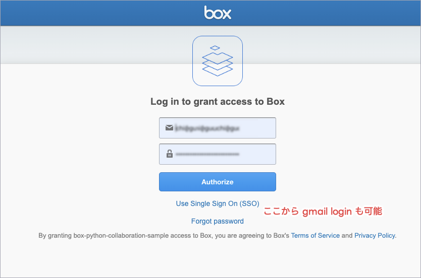
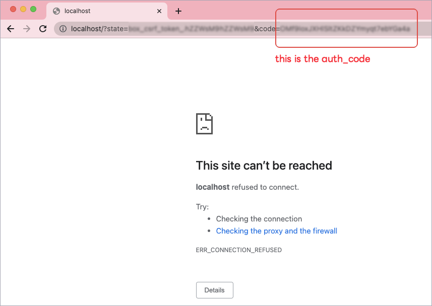
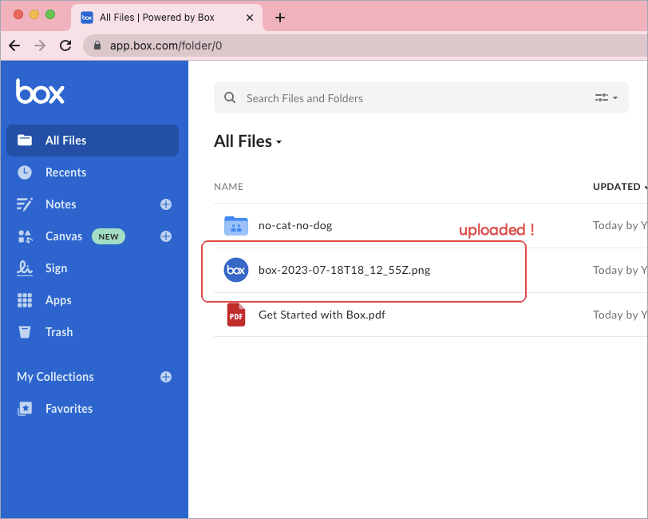

Box + Python collaboration sample
===

Python から Box を操作する OAuth 2.0 / JWT のサンプル集です。

| | バージョン |
| --- | --- |
| Python | 3.14 |
| Box SDK | boxsdk 10 系 (`box_sdk_gen`) |
| テスト / Lint | pytest, flake8, mypy |

## モックでテストする

```bash
pipenv sync --dev
pipenv run pytest
pipenv run flake8
pipenv run mypy .
```

- テストでは Box SDK の client を fake に差し替え、network access も遮断します。本物の Box には接続しません。
- 本物の Box との接続は未検証です。

## 本物の Box で動かす

スクリプトは Box 上で folder 作成、file upload、metadata 登録を行います。テスト用 account で実行してください。

`.env` を置くと pipenv が読み込みます (`.env` と `*.json` は gitignore 済みです)。

```
# oauth2_sample.py 用
CLIENT_ID = '...'
CLIENT_SECRET = '...'

# jwt_sample.py / jwt_sample_metadata.py 用 (DEVELOPER_TOKEN があればそっち優先)
DEVELOPER_TOKEN = '...'
SETTINGS_FILE_SYS_PATH = '...'  # JWT の config.json のパス
METADATA_TEMPLATE_KEY = '...'
```

## OAuth2 のほう

### Demo

```bash
# こうやって実行すると……
$ pipenv run python oauth2_sample.py

# Box のここへアクセスしてくださいと言われるので、ブラウザでアクセスすると……
Go to this url on your browser: https://account.box.com/api/oauth2/authorize?...
```

認証ページが開きます。



認証に成功すると、 "OAuth 2.0 Redirect URI" へ redirect されます。



```bash
# address bar の URL をそのまま貼り付けます。state が一致しない場合は停止します
Paste the redirected URL: http://localhost/?state=...&code=...
File "box-2023-07-18T18_12_55Z.png" has been uploaded to Box with file ID: ...
```

token は画面へ表示しません。

upload できました。



### まあ Box 側でアプリケーションを作らないといけないけどね

1. ここ↓でアプリケーションを作っていく
    - https://app.box.com/developers/console/newapp
2. Custom App (OAuth 2.0 User Authentication)
    - Purpose: Integration
    - 多分このへん↑はアンケなので適当でいい
    - OAuth 2.0 User Authentication を選ぶ
3. Custom App の設定をする
    - OAuth 2.0 Credentials で Client ID と Client Secret をコピーしとく。
    - OAuth 2.0 Redirect URI: `http://localhost`
    - Application Scopes
        - ここがアプリケーションの権限スコープだね。今回はファイルをアップロードしたいので "write all files ..." にチェックしとくか。

### このプログラムに追加できるとすれば

- 毎回認証ページに飛ばすんじゃなくて、 `refresh_token` を使って認証をスキップするようにする
- アップロード先のフォルダを指定できるようにする

とかかな。

## JWT のほう

### Demo

```bash
$ pipenv run python jwt_sample.py
```

1. `電子帳簿保存/電子帳簿保存_公開/電子帳簿保存_受領` フォルダを探す
2. その中に `サブフォルダ` がなければ作る
3. `box.png` をアップロードして URL を出す
4. `METADATA_TEMPLATE_KEY` の template で metadata を登録する (field は利用する template に合わせて変更してください)

```bash
# template の enum field の選択肢だけを表示します
$ pipenv run python jwt_sample_metadata.py
```

### まあ Box 側でアプリケーションを作らないといけないけどね

1. ここ↓でアプリケーションを作っていく
    - https://app.box.com/developers/console/newapp
2. Custom App (Server Authentication with JWT)
3. アカウントの 2-Step Verification を設定する (Public/Private Keypair を作るために必要)
4. Custom App の設定をする
    - Application Scopes 追加
    - Add and Manage Public Keys で Generate a Public/Private Keypair
    - CORS Domains (たぶんコレがいる?)
5. Authorization タブで Review and Submit する
6. Admin Console でアプリケーションを承認する
